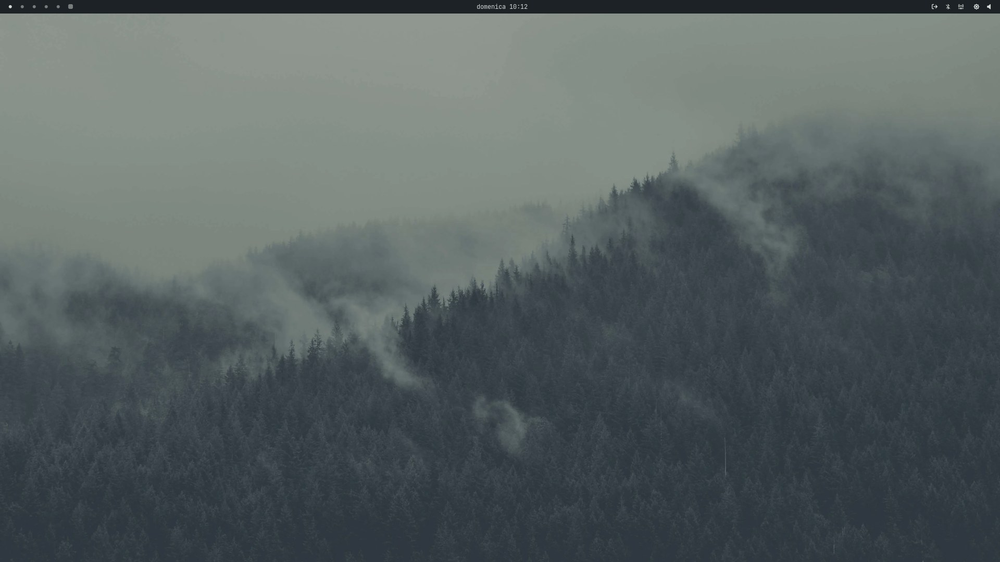
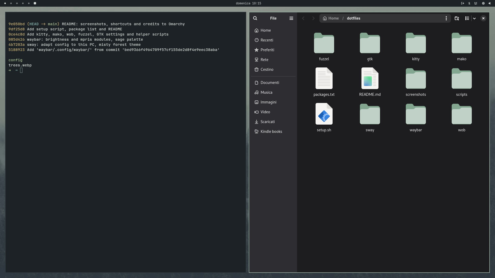
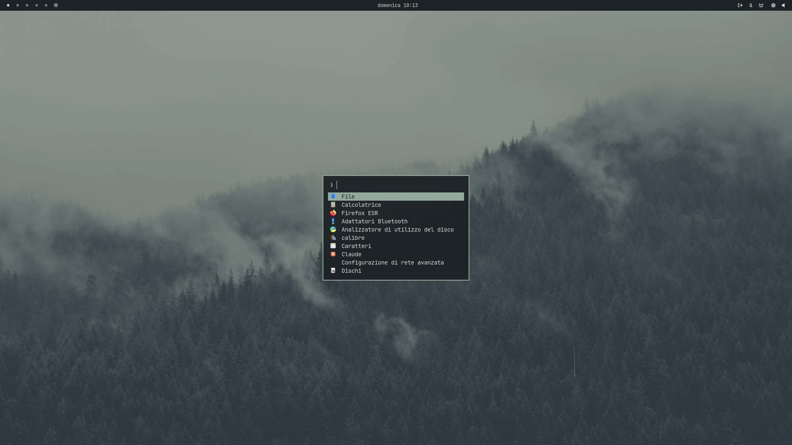
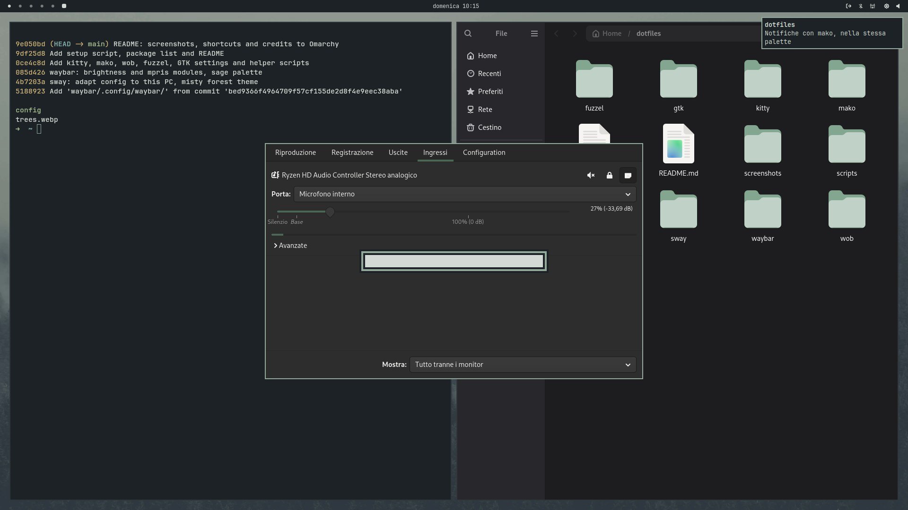
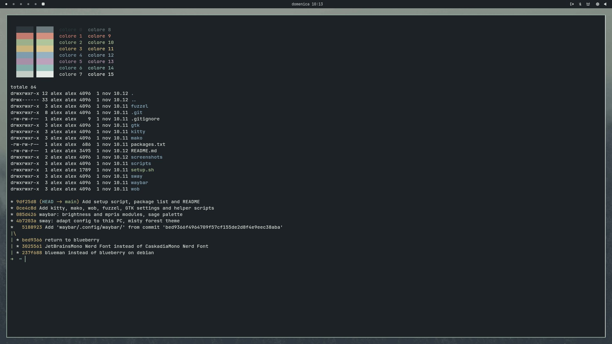

# dotfiles

sway configuration for Debian 13, inspired by [Omarchy](https://github.com/basecamp/omarchy).
Grey-green theme with a sage accent `#93a99c`, derived from the `trees.webp` wallpaper of Omarchy's
Everforest theme.



| | |
|---|---|
|  |  |
| Tiling with kitty and Nautilus, sage border on the focused window | fuzzel launcher (`$mod+d`) |
|  |  |
| Floating pavucontrol, mako notification and wob bar | kitty palette |

## Components

| | |
|---|---|
| Window manager | sway |
| Bar | Waybar (workspaces, media, clock, tray, bluetooth, network, brightness, volume) |
| Launcher | fuzzel |
| Terminal | kitty |
| Notifications | mako |
| On-screen volume and brightness | wob |
| GTK and icon theme | Dark Adwaita with a sage accent, generated by `gtk-sage-theme` |
| Font | JetBrainsMono Nerd Font |
| Browser | Firefox with the Misty Forest theme (same palette) |

## Installation

```bash
git clone https://github.com/alexmarchi28/dotfiles.git ~/dotfiles
~/dotfiles/setup.sh
```

`setup.sh` installs the packages listed in `packages.txt` and the JetBrainsMono Nerd Font, creates the
links with GNU Stow (existing files are moved to `~/.dotfiles-backup-<date>`), generates the
Adwaita-sage theme and sets the dark style, GTK theme and icon theme with `gsettings`. It also links
`firefox/user.js` into the default Firefox profile and opens the Misty Forest theme for installation
(Firefox must have been started at least once).

## Layout

Each folder is a Stow package that mirrors the paths starting from `~`:

| Package | Contents |
|---|---|
| `sway` | sway config and wallpaper |
| `waybar` | bar, style, brightness module (`brightness.sh`) |
| `kitty` | terminal |
| `mako` | notifications |
| `wob` | on-screen volume and brightness bar |
| `fuzzel` | application launcher |
| `gtk` | dark style and sage accent for libadwaita apps |
| `scripts` | `monictrl` (brightness/contrast via DDC/CI), `gtk-sage-theme` |

`firefox/` is not a Stow package (the profile path changes on every PC): `setup.sh` handles it.

| Path | Contents |
|---|---|
| `firefox/misty-forest/` | source of the Misty Forest theme (`manifest.json`) |
| `firefox/misty-forest-1.0.xpi` | the same theme, signed by Mozilla |
| `firefox/user.js` | preferences (no Firefox-drawn title bar, sway decorates the window) |

To change a config, just edit the file in its usual place (e.g. `~/.config/sway/config`):
it is a link to the file in this repository.

To add a package: create `name/.config/name/...`, move the file there and run
`stow --target="$HOME" name` from `~/dotfiles`.

## Main shortcuts

| Keys | Action |
|---|---|
| `$mod+Enter` | terminal |
| `$mod+d` | launcher |
| `$mod+Shift+b` | Firefox |
| `$mod+Shift+q` | close window |
| `$mod+h/j/k/l` or arrows | move focus |
| `$mod+Shift+h/j/k/l` | move window |
| `$mod+1…0` | switch workspace |
| `$mod+r` | resize mode |
| Volume knob | volume |
| `Ctrl` + volume knob | monitor brightness |
| `$mod+Shift+u/d` | monitor brightness |
| `$mod+Ctrl+u/d` | monitor contrast |
| `Print` / `Shift+Print` | full screenshot / area screenshot to clipboard |
| `$mod+Shift+p` | suspend |
| `$mod+Shift+e` | log out |

`$mod` is the Windows key.

## Notes

- **Brightness**: the external monitor is controlled over DDC/CI with `ddcutil`: Ctrl + volume knob,
  scrolling on the Waybar icon or `$mod+Shift+u/d`. wob shows the final value right away while the
  monitor catches up in the background. If `ddcutil` cannot access `/dev/i2c-*`:
  `sudo usermod -aG i2c $USER` and log in again.
- **Adwaita-sage theme**: it is generated by `gtk-sage-theme` and is not stored in the repository. sway
  regenerates it at startup whenever GTK or the Adwaita icons get updated.
- **Firefox theme**: to change it, edit `firefox/misty-forest/manifest.json`, bump `version` and
  upload the folder as a zip to [addons.mozilla.org](https://addons.mozilla.org/developers/) as an
  unlisted add-on to get a new signed `.xpi`. With Firefox Sync the active theme is synced too.
- **Settings outside of files**: dark style, GTK theme and icon theme are `gsettings` values, applied
  by `setup.sh`.

## Credits

- [Omarchy](https://github.com/basecamp/omarchy): overall inspiration for this setup.
- The `trees.webp` wallpaper comes from Omarchy's **Everforest** theme.
- The Waybar configuration (`config.jsonc`, `style.css`) started from Omarchy's and was adapted to sway
  and to this PC.
